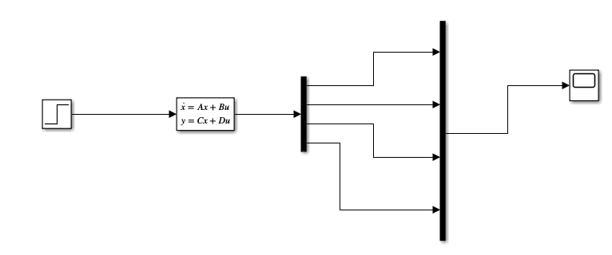
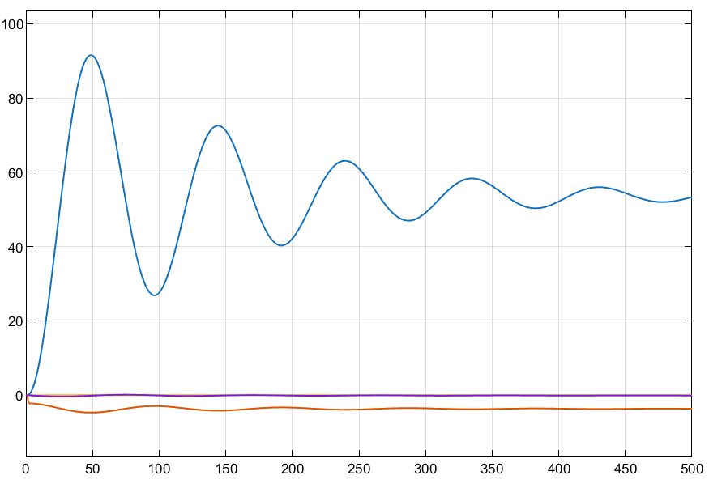
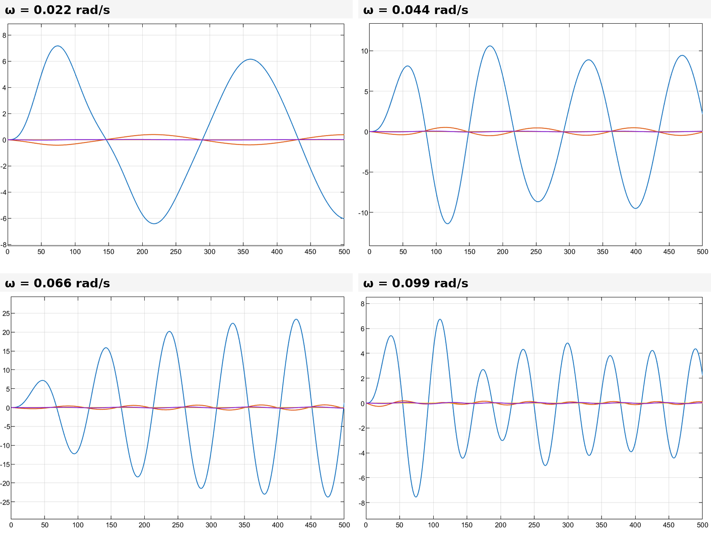
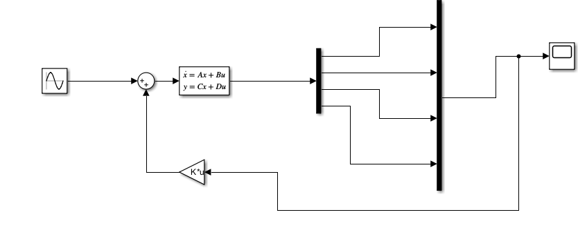
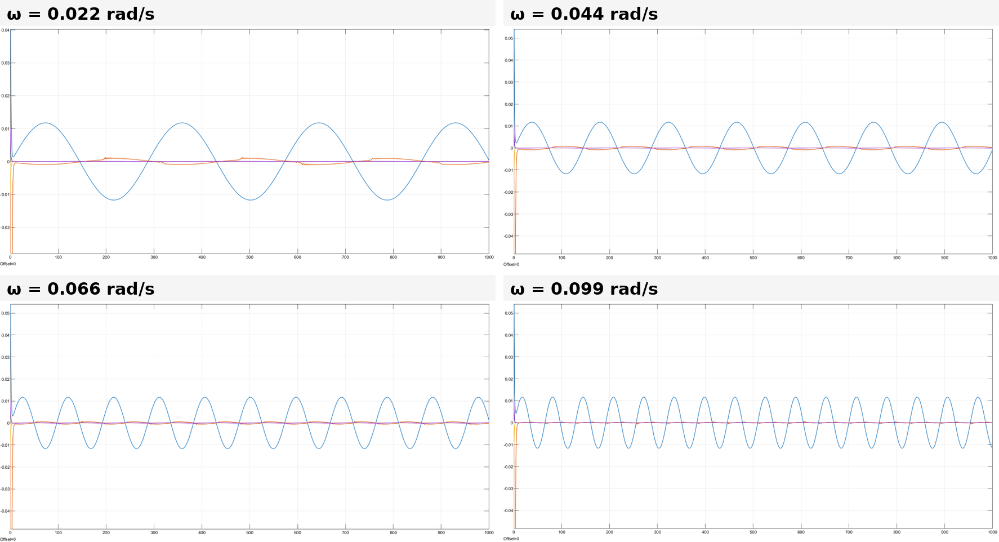

# Aircraft Longitudinal Dynamics and Pole-Placement Autopilot — MATLAB / Simulink

Linearization of a longitudinal aircraft model, analysis of its stability modes, Simulink simulation of its open-loop response, and design of a state-feedback autopilot by pole placement, tested against a sinusoidal elevator disturbance.

**Author:** Yanis Boutabia — *IPSA Paris, project Au324 "Analysis and simulation of dynamical systems" (report in French), March 2025.*

*See also: a more detailed flight-mechanics study with MIL-F-8785C flying-qualities assessment and SAS design is in [C2-Flying-Qualities-MATLAB](https://github.com/Yanis-Boutabia/C2-Flying-Qualities-MATLAB).*

## Model

Simplified longitudinal aircraft model (point-mass translation plus pitch rotation):

```
m·v̇ = Fx − m·g·sin(θ) − m·q·w
m·ẇ = Fz + m·g·cos(θ) + m·q·v
Iy·q̇ = M
θ̇ = q
```

The state is X = [v, w, q, θ] (longitudinal and vertical speeds, pitch rate, pitch angle), the input is the elevator deflection u = δe, and all states are assumed measurable (y = X, so C = I and D = 0). With the forces and moment expressed through the aerodynamic coefficients, the model is a nonlinear system Ẋ = f(X, u).

## Linearization

The model is linearized around steady level flight at v₀ = 186 m/s (X₀ = [v₀, 0, 0, 0]), with sin θ ≈ θ and cos θ ≈ 1:

```
      [ -0.0156    0.0101     0      -9.81 ]         [  0       ]
A =   [ -0.1367   -1.9635   186       0    ]    B =  [  0.1351  ]
      [  0.000948 -0.02555  -3.6668   0    ]         [ -0.14456 ]
      [  0         0         1        0    ]         [  0       ]
```

`rank(ctrb(A, B)) = 4`: the system is fully controllable from the elevator alone, so all four states can be driven by δe and arbitrary pole placement is possible.

## Stability modes

Eigenvalues of A (computed with `eig`):

| Mode | Eigenvalues | ωₙ (rad/s) | ξ | Period |
|---|---|---|---|---|
| Short period | −2.8157 ± 2.0067j | 3.46 | 0.81 | 3.1 s |
| Phugoid (long period) | −0.0073 ± 0.0659j | 0.066 | 0.11 | 95 s |

(ωₙ, ξ and the period are derived from the eigenvalues.) All real parts are negative, so the open-loop system is stable. Both modes are oscillatory: the short-period mode is fast and well damped, while the phugoid is slow and very lightly damped, so its oscillations in speed and altitude last a long time and sometimes need pilot corrections.

## Open-loop simulation (Simulink)

The linear model is simulated with a State-Space block, first with a step input, then with a sinusoidal elevator input.


*Open-loop Simulink model (step source → State-Space block → scope)*

**Step response.** The speed v (largest curve) overshoots to about 92 m/s at t ≈ 48 s, then oscillates toward about 53 m/s with the 95 s period of the phugoid. The other states stay much smaller.


*Open-loop response to a unit step on δe*

**Sinusoidal elevator input** u = 0.1·sin(ωt) at ω = 0.022, 0.044, 0.066 and 0.099 rad/s, a range that brackets the phugoid frequency. The speed oscillation is largest at ω = 0.066 rad/s, where it grows to about 23 m/s, against roughly 5 to 10 m/s at the three other frequencies. This is a resonance: 0.066 rad/s is the natural frequency of the lightly damped phugoid.


*Open-loop response to u = 0.1·sin(ωt) for four frequencies — the largest curve is the speed v*

## Pole-placement autopilot

A state-feedback law u = −K·X is designed with MATLAB's `place` so that the closed-loop poles sit at real, stable locations and the response has no oscillation. Two designs appear in the project:

| | Design A (report, parts 3a–b) | Design B (saved script and model) |
|---|---|---|
| Desired poles | −4, −6, −8, −10 | −1, −2, −3, −4 |
| Gain K | [678.64, −0.0682, −154.70, −1552.56] | [8.28, 0.219, −29.91, −138.89] |
| Eigenvalues of A − B·K | −10, −8, −6, −4 | −4, −3, −2, −1 |

In both cases the eigenvalues of A − B·K are exactly the requested ones, all real and negative, so the closed loop is stable without oscillation. Faster poles require much larger gains. The script in `code/` contains design B; design A is obtained by changing `poles_desires`. A third pole set ([−2, −1, −3, −9]) was also tested in Simulink with initial conditions [1, 5, 3, 8]: the response is stable and returns quickly to equilibrium.

## Autopilot against a sinusoidal disturbance

The disturbance of the open-loop study is added to the control law. The saved model computes u = −u_p − K·X with u_p = 0.1·sin(ωt), which only changes the phase of the disturbance. These runs use design B and the initial state [0.1, 0, 0, 0.01].


*Closed-loop Simulink model with state feedback (−K) and the sinusoidal disturbance*

With feedback, the largest response (the speed v) stays within about ±0.012, orders of magnitude below the ±5 to ±23 of the open loop, whatever the frequency, with no resonance near the phugoid frequency. After a brief initial transient due to the non-zero initial state, the response is a forced oscillation at the disturbance frequency that does not decay, because the disturbance is sustained. What the autopilot changes is its amplitude and the disappearance of the lightly damped phugoid resonance. The faster design A would reduce the speed oscillation further, to about ±1.5×10⁻⁴ (computed with the same model), at the price of gains about ten times larger. This is the practical value of an autopilot: it keeps the aircraft stable and limits the effect of external disturbances.


*Closed-loop response to the sinusoidal disturbance for the same four frequencies (design B)*

## Limitations and possible extensions

- Faster poles mean larger gains (up to about 1.55×10³ for design A) and no actuator limit is modelled. With the large initial conditions [1, 5, 3, 8] (θ₀ = 8 rad), the commanded deflection u = −K·X₀ reaches about 2.5×10³ rad for the third pole set. Such a case is far outside the validity of the linear small-perturbation model, so it demonstrates stability only mathematically.
- The pole locations were chosen to be stable and non-oscillating, without a flying-qualities requirement or a control-effort criterion.
- The study uses a linear model around a single trim speed (186 m/s) and was not validated against a nonlinear simulation.
- Full-state feedback assumes all states are measurable; a real autopilot would need sensors and possibly an observer.

## Repository content

```
Aircraft-Longitudinal-Control-Simulink/
├── README.md
├── code/
│   ├── longitudinal_pole_placement.m   # model matrices, controllability, eigenvalues, pole placement
│   └── autopilot_closed_loop.slx       # Simulink closed loop: state feedback + sinusoidal disturbance
└── images/                             # figures from the report
```

**How to run:** run the script first, it defines A, B, C, D and K in the workspace, which the Simulink model reads. Then open the model. The saved configuration is the closed loop with the disturbance at 0.099 rad/s (amplitude 0.1), initial state [0.1, 0, 0, 0.01] and a 1000 s simulation. Change the frequency of the sine block to reproduce the other cases. The model was saved with MATLAB R2024a and needs the Control System Toolbox for `ctrb` and `place`.

## Tools

`MATLAB` (R2024a) — `ctrb`, `eig`, `place` · `Simulink` — State-Space, Step, Sine Wave, Gain and Sum blocks

---
*Academic project — IPSA Paris, March 2025.*
